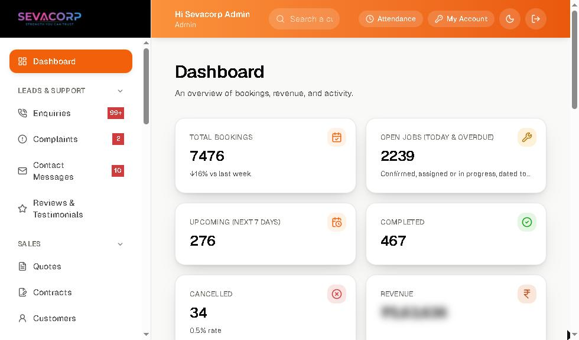
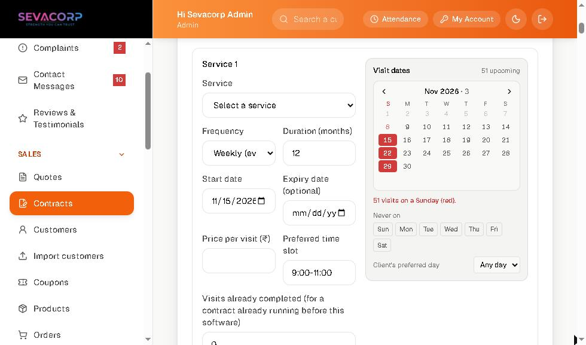
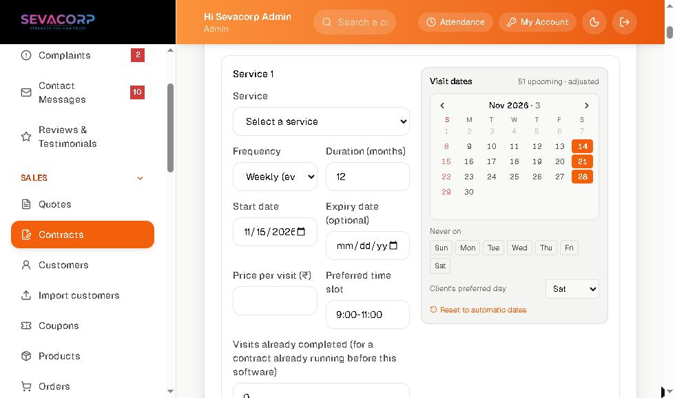
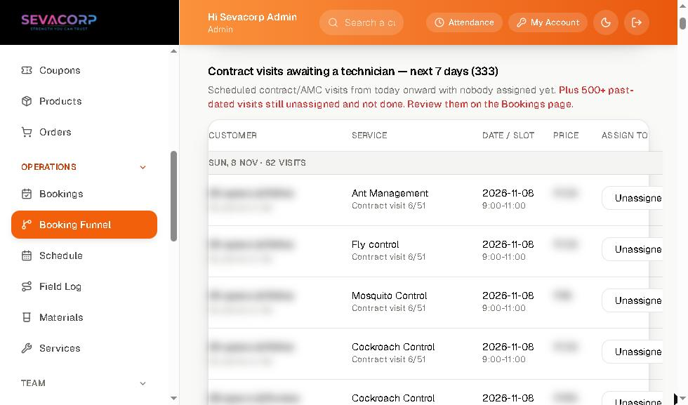

# Sevacorp Admin: an operations dashboard for a field-service business

**Role:** Founder & product/tech lead. I designed, specified and shipped this solo.
**Business:** [Sevacorp Services Ltd](https://sevacorp.in), a pest-control & home-services company in Pune (est. 2017).
**Status:** In daily production use by the office team, technicians and owners.

> This repo is a **case study**. The production code is private because it runs a real business with real customer data. All screenshots are from the live system, with customer names, phone numbers and revenue blurred.

## The problem

Sevacorp ran on paper job cards, WhatsApp groups and Tally. Nobody could answer simple questions quickly:

- Which contract visits are due this week, and who is going?
- Which leads did sales never call back?
- Which technician is holding cash, and how much?
- Did the technician actually reach the site on time?

## What I built

One web admin, plus a technician app and a customer app, all on one backend:

| Area | What it does |
|---|---|
| **Leads & support** | Enquiries pipeline with sales-rep assignment and follow-up dates, complaints register, website contact messages, reviews moderation |
| **Sales** | Quotations with PDF + WhatsApp sharing, recurring service **contracts** (AMC / commercial), customer & company records, bulk import |
| **Operations** | Bookings, schedule calendar, booking funnel (unassigned work + abandoned checkouts), field log, materials & chemical stock |
| **Team** | Staff, live technician locations + day timeline, automatic staff alerts, performance, attendance, payroll with PDF slips, cash collections |
| **Automation** | WhatsApp visit confirmations, job updates, win-back offers, AI WhatsApp assistant, cash & low-stock reminders |
| **Accounts** | GST invoices (CGST/SGST split), Tally XML export |

## Design decisions I'm proud of

### 1. Show the schedule *before* it's created
Picking "Weekly" from a dropdown silently generated a year of visits, and many landed on Sundays or on days the client's site is shut. The office only found out when a technician turned up at a locked gate.

I put a small calendar **right next to the frequency field** that previews every visit as you type. Sundays are flagged in red with a count. The admin can block weekdays, snap every visit to the client's preferred day, or click a visit and then click another day to move it.

| Before adjusting | After choosing "Saturday" |
|---|---|
|  |  |

### 2. Numbers that mean what they say
The dashboard used to show **~7,000 "active jobs"** and **"down 100% vs last week"**. Contract visits are generated months ahead, so both numbers were technically true and useless. I redefined them around the question the owner actually asks:

- **Open jobs** = work due *today or overdue*
- **Upcoming** = the next 7 days
- Trends and charts by **visit date**, not by the date a record was created

The real figure turned out to be ~2,200 overdue visits that were never closed. That's a process problem the old dashboard was hiding.

### 3. Lists that can't silently lie
Two lists hit API caps without telling anyone: enquiries stopped at 200 (sales had 427), and the booking funnel stopped at 500. I split the funnel into *app bookings* vs *contract visits this week*, grouped by day, with a separate count of past-dated unassigned work. Enquiries now page with "Load more" and flag overdue follow-ups.

### 4. Fail gently
A momentary server restart used to blank the entire admin with "Failed to fetch". The app now retries quietly (1s, 2s, 4s), keeps an already-verified session, and only shows an error if the server is really down.

### 5. Small things office staff notice
- One Indian-format money style everywhere (₹1,17,590, not ₹117590.08)
- Tables size columns to their content, so action buttons are never clipped on a laptop
- Confirmations on every destructive action; staff names auto-capitalised; designation follows the staff type

## Stack

- **Admin:** Next.js, React, TypeScript, Tailwind CSS, deployed on Vercel
- **Mobile:** React Native / Expo (technician + customer apps), background location, FCM push
- **Backend:** FastAPI (Python), MongoDB Atlas, deployed on Render
- **Integrations:** Razorpay, WhatsApp Cloud API, MSG91 (OTP), Google Maps, Gemini (AI pest ID & WhatsApp assistant), Tally

## How I work

I'm an Instrumentation & Control engineering student and the technical lead of my family's business. I build with AI coding assistants for most of the implementation. My part is product and UX: deciding what to build, designing the flows, reviewing every change, and testing it against how the office actually works.

---

**Soham Chavhan** · Pune, India · [sevacorp.in](https://sevacorp.in)